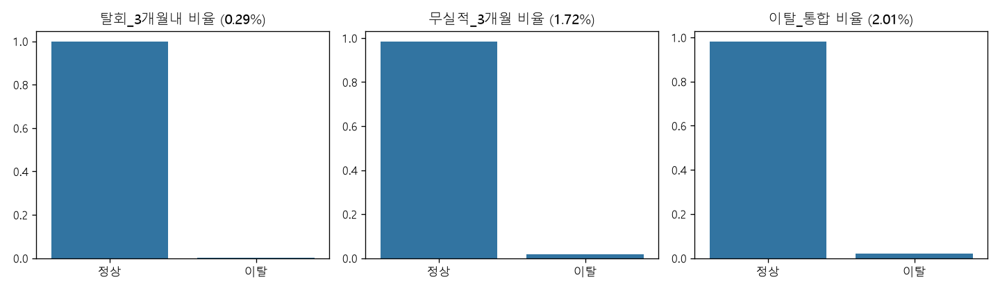
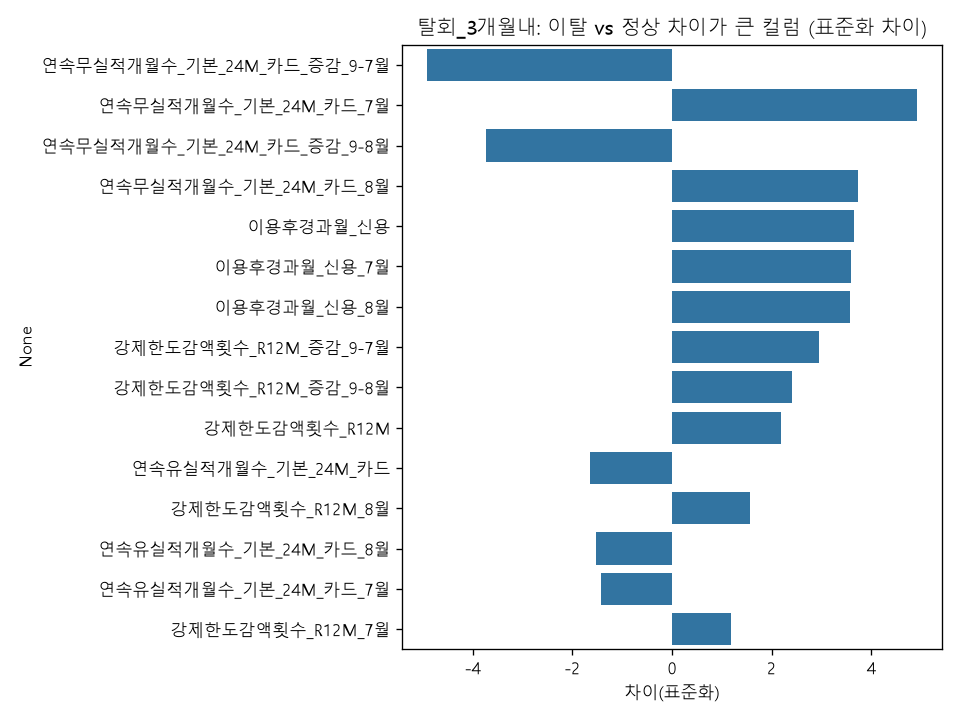
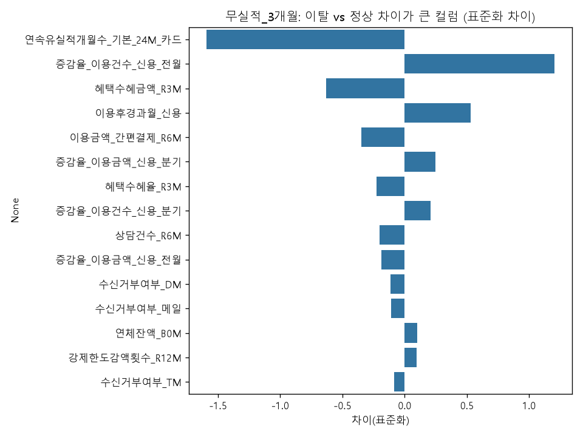
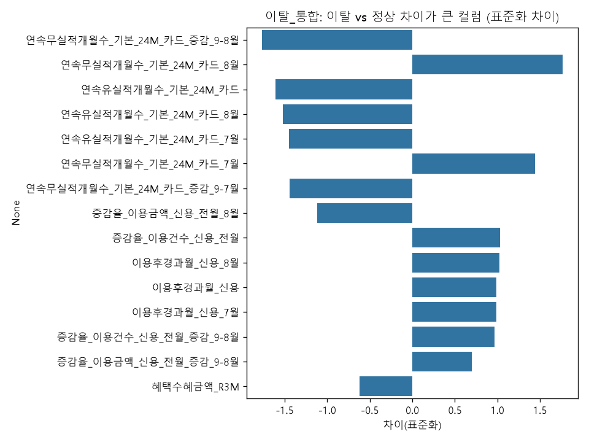
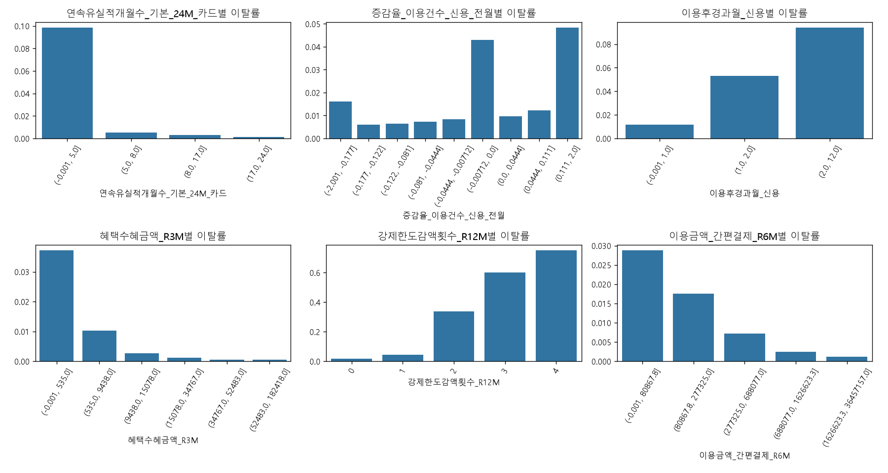
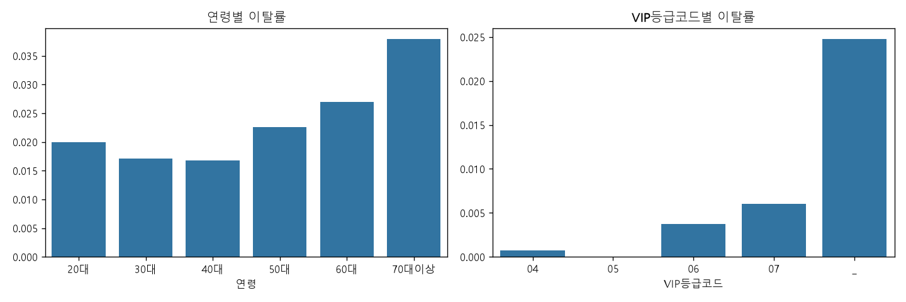
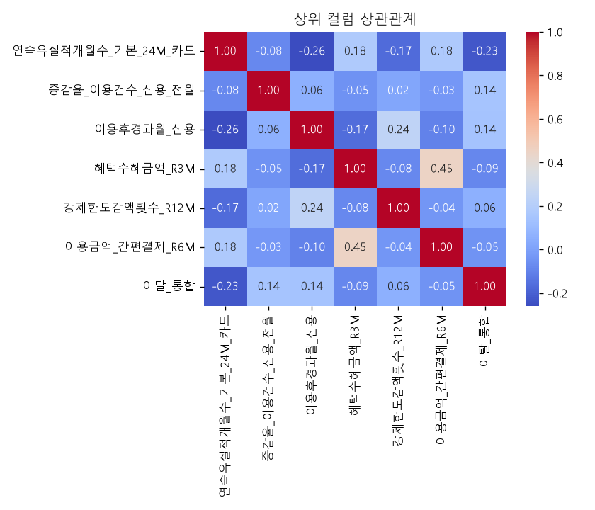

# GuardVIP with Hana

## 0. 팀원 소개 및 역할

<!-- prettier-ignore-start -->
| 권승현 | 김민혁 | 박세윤 | 한세현 |
| :---: | :---: | :---: | :---: 
| |  | | 
| 팀장 | 팀원 | 팀원 | 팀원
| 모델 학습 및 고도화 작업, AI 챗봇 구현 | 모델별 과적합 확인,  streamlit 화면 구현 | 데이터 전처리 결과, 모델 학습 결과, 학습된 모델 결과분석 보고서 작성 | 데이터 전처리,  README 작성
|  |  |  |  |
<!-- prettier-ignore-end -->

---
## 1. 프로젝트 개요

프로젝트 주제: **💳 카드 고객 이탈 예측 및 대시보드 구축 💸**

### 1-1. 개요
본 프로젝트는 국내 카드사의 VIP 회원 금융 데이터를 기반으로 고객 이탈(Churn) 여부를 예측하는 머신러닝 모델을 구축하고, 이를 활용한 인터랙티브 대시보드를 제공하는 것을 목표로 한다. 
2018년 9월 활성 고객 데이터를 기준으로 3개월 내 탈회·무실적 여부를 예측하기 위한 마스터셋을 구성하였으며, 7~8월 과거 이용 특성 및 증감 변수까지 확장한 철저한 탐색적 데이터 분석(EDA)과 전처리를 거쳐 총 6개의 분류 모델(XGBoost, LightGBM, CatBoost, ExtraTrees, Random Forest, MLP)을 적용 및 비교·분석하였다. 나아가 예측 성능을 극대화하고 실시간 대시보드 서빙을 최적화하기 위해 다중 모델 결합(Average Ensemble 및 Stacking) 기법을 도입하여 최종 예측력을 검증하였다.

### 1-2. 프로젝트 배경

 
https://news.dealsitetv.com/articles/163781 | https://www.kbanker.co.kr/news/articleView.html?idxno=224331 | 

최근 고금리와 고물가 장기화로 소비 심리가 위축되고 금융 시장 변동성이 심해지면서 일반 회원의 이탈이 늘고 신규 유입이 정체되는 상황이다. 그래서 카드사는 신규 유치보다 회사의 실질적 매출과 수익성을 이끄는 VIP 고객의 생애 가치(LTV) 극대화와 선제적 이탈 방지(Retention)가 훨씬 중요해졌다. 특히 일시적인 외부 충격이나 이슈로 인한 이탈과 달리, 평상시 VIP 고객의 이탈은 과거 이용 금액 감소, 카드론/리볼빙 등 금융 서비스 이용 패턴 변화, 혜택 체감도 저하 같은 복합적인 사전 징후를 동반한다. 그래서 "VIP 고객은 평소 어떤 이유와 징후로 이탈하는가?"에 대한 본질적인 분석이 필수적이다.
이에 따라 본 프로젝트는 하나카드 VIP 활성 고객의 과거 이용 특성과 시계열 증감 변수를 탐색적으로 분석해서 이탈 3개월 전의 미세한 징후를 머신러닝으로 포착하고, 이를 학습해 VIP 고객의 사전 이탈을 감지하고 대비할 수 있는 방어 체계를 구축하고자 한다.

### 1-3. 프로젝트 목표
- AI Hub 금융 합성 데이터를 활용한 234만여 명 규모의 데이터 통합 및 고객 이탈 예측 모델 설계
- 클래스 불균형(`이탈 통합 비율 2.01%`)을 고려한 정밀한 전처리 및 평가지표(`Recall`, `Precision`, `F1-Score`, `PR-AUC`) 중심 모델 검증
- Streamlit을 활용한 실시간 이탈 예측 및 시각화 대시보드 구현

---
## 2. 🛠 Tech Stack
| Category | Stack |
|----------|-------|
| 💻 Language |  |
| 📊 Data Processing |   |
| 🤖 Machine Learning |          |
| 🧠 AI & Chatbot |     |
| 🖥️ Web Framework |  |
| 📈 Visualization |   |

---

## 3. 업무 분할 구조
* **데이터 전처리 및 EDA**: 원천 데이터 8개 영역 결합, 7~8월 과거 시점 확장 특성 생성, 결측치/이상치 처리, 마스터셋 구성
* **모델링 및 하이퍼파라미터 튜닝**: 10% 샘플 데이터 기반 120개 앙상블 조합 탐색 및 전체 데이터 스케일 업(Scale-up) 재튜닝
* **대시보드 구현**: Streamlit 기반 UI 구성, 최적 앙상블 모델 추론 연동, LLM 피드백 연동 기능 구현

---
## 4. 데이터 수집 및 정의
### 4-1. 금융 합성 데이터 개요
- **데이터 출처**: AI Hub 금융 합성 데이터 (하나카드 원천 기반)
- **원천 범위**: 2018년 7월 ~ 12월 (6개월), 8개 업무 영역, 월별 300만 행
- **분석 기준 시점**: 2018년 9월 활성 고객 대상 (2,345,394행 × 41열, 7~8월 과거 특성 확장)

### 4-2. 목표 변수(Target) 정의 및 비율
- **탈회 3개월 내 (`탈회_3개월내`)**: 비율 **0.29%**
- **무실적 3개월 (`무실적_3개월`)**: 비율 **1.72%**
- **이탈 통합 (`이탈_통합`)**: 탈회 또는 무실적 조건을 충족하는 경우, 비율 **2.01%** (정상 고객 97.99%)

  

>  **클래스 불균형**: 정상 고객이 97.99%로 심한 불균형을 보여 정확도(Accuracy) 대신 **Recall, Precision, F1-Score, PR-AUC**를 핵심 평가지표로 활용함.

---
## 5. 데이터 통합 & 전처리 및 EDA

### 5-1. 데이터 변수 사전 (Data Dictionary)
분석 및 모델링에 사용된 총 43개의 설명변수 중, 이탈 판별 기여도가 가장 높은 **핵심 변수 12개**의 명세이다.

| 분류 | 컬럼명 | 설명 | 비고 |
| :--- | :--- | :--- | :--- |
| **Target** | `이탈_통합` | 기준 시점 이후 3개월 내 탈회 또는 무실적 도달 여부 | 1: 이탈, 0: 정상 (이탈률 2.01%) |
| **Target** | `탈회_3개월내` | 기준 시점 이후 3개월 내 탈회 여부 | 0.29% |
| **Target** | `무실적_3개월` | 기준 시점 이후 3개월 간 이용 실적 중단 여부 | 1.72% |
| **이용패턴** | `연속유실적개월수_기본_24M_카드` | 과거 24개월 중 연속으로 카드 실적이 발생한 개월 수 | 무실적 및 통합 이탈 차이 1위 변수 |
| **이용패턴** | `연속무실적개월수_기본_24M_카드_7/8월` | 7월 및 8월 기준 과거 24개월 내 연속 무실적 개월 수 | 탈회/통합 이탈 위험 주요 변수 |
| **이용패턴** | `이용후경과월_신용` | 신용카드를 마지막으로 이용한 뒤 경과한 개월 수 | 탈회 집단 차이 주요 변수 |
| **변동성** | `연속무실적개월수_증감_9-7/8월` | 9월 대비 7월, 8월의 연속 무실적 개월 수 증감량 | 탈회/통합 이탈 집단 차이 상위 변수 |
| **변동성** | `증감율_이용금액/건수_신용_전월` | 전월 대비 신용카드 이용 금액 및 건수 증감율 | |
| **한도/연체** | `강제한도감액횟수_R12M_증감_9-7/8월` | 9월 대비 과거 월의 강제 한도 감액 횟수 증감량 | 탈회 집단 차이 주요 변수 |
| **혜택** | `혜택수혜금액_R3M_7/8월` | 7월, 8월 기준 최근 3개월 간 고객이 받은 혜택 금액 | |
| **고객특성** | `연령` / `VIP등급코드` | 고객의 연령대 및 VIP 등급 | 더미 인코딩 적용 |

### 5-2. EDA (탐색적 데이터 분석) 단계별 주요 결과
2018년 9월 활성 고객을 기준으로 7~8월 과거 시점 특성 및 월별 증감 변수를 활용하여 다각도로 분석함.

* **1단계: 타겟 변수 및 평가지표 정의**
  * 정상 고객이 97.99%를 차지하는 극심한 불균형 데이터임을 확인하여, Accuracy 대신 PR-AUC와 Recall, Precision 중심의 평가지표를 설정함.
* **2단계: 이탈 vs 정상 집단 간 7~9월 다변량 행동 패턴 비교**
  * **탈회 집단:** 7~8월 시점의 `연속무실적개월수`가 매우 높고, 9월 대비 7/8월 증감 변수에서 가장 뚜렷한 집단 차이를 보임.
  * **무실적 집단:** 7, 8, 9월 전반에 걸쳐 `연속유실적개월수`가 정상 집단(약 15개월) 대비 현저히 낮음(약 2.7개월).
  * **통합 이탈:** 8월 시점의 `연속무실적개월수`와 9~8월 증감 변수가 핵심 위험 지표로 확인됨.
* **3단계: 인구통계학적 특성 및 구간별 위험도 분석**
  * 30~40대의 이탈률이 가장 낮았으며, **50대 이후 상승하여 70대 이상 고연령층(약 3.8%)에서 가장 높게** 나타남.
* **4단계: 다중공선성 및 변수 중복성 점검 (상관관계 분석)**
  * 7, 8, 9월의 `연속유실적개월수` 간 매우 높은 양의 상관(0.95~0.97) 및 일부 증감 파생변수 간 완전한 음의 상관(-1.00)을 확인하여 모델 학습 시 변수 중복 통제가 필요함을 점검함.

#### 📊 주요 EDA 시각화 자료
1. **탈회 집단 7~9월 특성 표준화 평균 차이**

  

2. **무실적 집단 7~9월 특성 표준화 평균 차이**

  

3. **통합 이탈 집단 7~9월 특성 표준화 평균 차이**

  

4. **월별 연속유/무실적 개월 수 구간별 이탈률**

  

5. **연령대별 및 VIP 등급별 이탈률**

  

6. **7-8월 포함 월별 주요 변수 상관관계 히트맵**

  

### 5-3. 컬럼별 데이터 전처리 내역
머신러닝 모델의 예측 성능을 안정적으로 확보하기 위해 변수의 특성에 맞춘 세밀한 전처리를 수행함. (최종 분할: `X_train` 1,876,315행 : `X_test` 469,079행 = 8 : 2)

| 전처리 기법 | 대상 컬럼 | 처리 방식 및 사유 |
| :--- | :--- | :--- |
| **결측치 처리** | `혜택수혜율_R3M` | • 총 53,750건의 결측치 확인 • 데이터 누수(Leakage) 방지를 위해 Test 셋을 배제하고 Train 데이터의 **중앙값(0.7647)** 으로 대체함 |
| **이상치 제한 (Clipping)** | `최종탈회후경과월`, `이용금액_간편결제_R6M`, `연속유실적개월수_기본_24M_카드`, `혜택수혜금액_R3M`, `캠페인접촉건수_R12M`, `증감율_이용건수_신용_전월/분기`, `증감율_이용금액_신용_전월/분기`, `혜택수혜율_R3M` | • 선형/거리 기반 모델의 왜곡을 방지하기 위해 주요 변수에 IQR 상·하한 경계값 기준 Clip 처리 수행 |
| **더미 인코딩** | `연령`, `VIP등급코드` | • 범주형(Categorical) 변수를 수치형 알고리즘이 인식할 수 있도록 0과 1의 더미 변수로 변환 |
| **스케일링** | 모든 수치형 변수 대상 (41개) | • 변수 간 스케일 차이를 맞추기 위해 StandardScaler 적용 • 데이터 누수 방지를 위해 Train 데이터로만 Fit 후 Test에 Transform 적용 |
| **데이터 누수 통제** | 7-8월 시점 변수 및 증감 변수 | • 9월 예측 시점 미래 정보(타겟 연관) 혼입 검증 및 분모 0 극단값 통제 |

---
## 6. 파생 변수
- 회원·신용·승인매출·청구·잔액·채널·마케팅·성과정보에서 선정한 변수를 고객-월 단위로 결합하고, 7~8월 과거 추세 및 증감 파생변수를 추가 생성하여 모델 입력 변수로 구축.

---

## 7. 모델링 및 평가 (전체 데이터 학습 기준)

*(※ 데이터 스케일 확장에 따른 과적합 방지를 위해, 먼저 10% 샘플 데이터로 탐색한 뒤 전체 데이터에 맞게 하이퍼파라미터를 재조정함)*

### 7-1. 전체 데이터 단일 모델 최종 성능

| 모델명 | PR-AUC | ROC-AUC | Recall | Precision | F1-Score |
| :--- | :---: | :---: | :---: | :---: | :---: |
| **ExtraTrees (ET)** | **0.4563** | 0.9630 | 0.8114 | 0.2812 | 0.4177 |
| **LightGBM (LGBM)** | **0.4526** | 0.9633 | **0.8198** | 0.2815 | 0.4191 |
| **XGBoost (XGB)** | **0.4555** | 0.9632 | 0.8149 | 0.2816 | 0.4186 |
| **CatBoost (CAT)** | **0.4528** | 0.9631 | 0.8089 | **0.2863** | **0.4229** |

### 7-2. 모델별 과적합 확인 결과

각 모델별로 학습용 데이터의 특성 중요도와 평가용 데이터의 특성 중요도를 비교하여 과적합을 판단하였습니다.
* ExtraTrees - 학습용 특성 중요도

* ExtraTrees - 평가용 특성 중요도

* LightGBM - 학습용 특성 중요도

* LightGBM - 평가용 특성 중요도

* XGBoost - 학습용 특성 중요도

  
* XGBoost - 평가용 특성 중요도

* CatBoost - 학습용 특성 중요도

  
* CatBoost - 평가용 특성 중요도

  

### 7-3. 다중 모델 앙상블 시너지 분석 결과

| 순위 | 조합명 (평균 앙상블) | 결합 모델 수 | PR-AUC | ROC-AUC | Recall | Precision | F1-Score | 비고 |
| :---: | :--- | :---: | :---: | :---: | :---: | :---: | :---: | :--- |
| **1** | **LGBM + ET** | **2** | **0.4592** | 0.9641 | 0.8157 | 0.2871 | 0.4247 |  |
| **2** | **LGBM + CAT + ET** | **3** | **0.4591** | **0.9642** | 0.8140 | **0.2880** | **0.4254** | |
| **3** | **XGB + LGBM + ET** | **3** | **0.4590** | 0.9641 | **0.8176** | 0.2868 | 0.4246 | 고재현율(Recall) |

## 8. Streamlit 구현
본 프로젝트의 웹 애플리케이션은 사용자 편의성을 위해 멀티 페이지 구조로 구현되었으며, 좌측 사이드바를 통해 페이지 이동 및 AI 제공자 설정을 지원한다.

### 8-1. 1페이지: 모델 개발 파이프라인 (Pipeline Overview)

  

* **데이터 전처리**: 데이터셋의 전체 고객 수 및 사용된 특성 개수를 표시하고, 기초적인 데이터 검사 결과를 제공한다.

  

* **탐색적 데이터 분석 (EDA)**: 타겟 변수의 심한 클래스 불균형 문제를 원형 차트로 시각화, 주요 수치형 변수의 분포를 이탈 고객과 정상 고객으로 나누어 비교 분석한다.

  

* **특성 선정 및 데이터 스플릿**: 모델 학습에 사용될 최종 인코딩된 피처 수와 Train/Test 데이터셋의 크기를 보여주고, 변환이 완료된 데이터셋의 샘플을 표 형태로 제공한다.

  

* **머신러닝 모델 기본 평가**: 튜닝 전 기본 설정 상태에서 다양한 모델의 성능을 0.5 임계값 기준으로 비교 분석한 표를 제공한다.

  

* **모델 최적화 (Tuning & Threshold)**: 모델별로 적용된 최적의 하이퍼파라미터 조합표를 상세히 제공하여 튜닝 과정을 검증한다.

  

* **과적합 상세 진단**: 학습용 데이터와 평가용 데이터의 특성 중요도를 각각 바 차트로 시각화하여 비교한다. 모델의 Train PR-AUC와 Test PR-AUC 격차를 수치로 제시하여 모델의 안정성 및 과적합 여부를 진단한다.

  

* **최종 모델 및 평가 지표 선정 보고서**: 2%라는 극심한 불균형 데이터 특성상 Accuracy의 한계를 설명하고, 이탈을 놓치지 않기 위한 Recall과 예측의 정확도를 위한 Precision을 동시에 고려하기 위해 판단 기준을 0.7로 설정하고 PR-AUC를 핵심 지표로 선정했음을 텍스트로 요약 제공

### 8-2. 2페이지: 고객 이탈 예측 대시보드 (Churn Dashboard)

  

* **대시보드 메인 및 요인 분석**: 고객 번호 입력을 통해 특정 고객의 데이터를 불러올 수 있다. 선택된 고객의 최종 '이탈 확률'과 '위험 등급'을 카드 및 게이지 차트로 한눈에 보여준다. 또한 SHAP 알고리즘을 연산하여 이탈 위험을 높이거나 낮추는 데 기여한 핵심 요인들을 우측 바 차트로 시각화하여 제시한다.

  

* **생성형 AI 챗봇 연동**: 화면 우측 상단의 'AI 챗봇' 버튼을 클릭하면 모달 형태의 챗봇 창이 활성화된다. 사용자가 질문을 자연어로 입력하면, 챗봇이 데이터 기반의 통계적 답변과 실무적 해석을 요약하여 즉각적으로 응답한다.

  

* **조정·비교 시나리오 시뮬레이션**: 모델 예측에 가장 큰 영향을 미치는 핵심 변수 10가지를 슬라이더 UI로 분리 제공한다. 실무자는 슬라이더를 조작하여 고객의 향후 행동 변화(예: 카드 연속사용 개월 수 감소, 혜택 수혜금액 증가 등)를 가정하고, 이에 따른 이탈 확률의 변화를 시뮬레이션할 수 있다.

  

* **권장 조치 및 맞춤형 전략 제안**: SHAP 분석 결과를 바탕으로, 해당 고객의 이탈 위험에 가장 크게 영향을 미친 상위 3개 요인에 대한 구체적인 마케팅/CRM 권장 조치를 카드 형태로 제안한다. 나머지 영향 요인들에 대한 조치 방안은 하단 접이식 탭을 통해 상세히 확인할 수 있어, 실질적인 고객 유지 전략 수립을 지원한다.

※ **시연 영상**: 

---
## 9. 인사이트 및 팀원 회고

### 9-1. 주요 인사이트
1. **데이터 누수 통제**: 은행 기준인 '12개월 무실적'을 기반으로 Y 데이터를 생성하는 과정에서 타겟 연관성이 지나치게 높은 변수들을 식별하고 통제하는 작업의 중요성을 확인함.
2. **클래스 불균형 대응**: 이탈률 2.01%의 불균형 데이터셋에서는 단순 Accuracy가 아닌 PR-AUC, Recall, Precision 중심의 평가 체계가 필수적이며, 모델별로 Precision과 Recall의 트레이드오프를 확인증명함.
3. **대용량 학습 대처**: 234만 행의 전체 데이터를 처음부터 앙상블 학습시키는 것은 시간과 리소스가 부족하다고 판단함. 이에 10% 샘플 데이터로 120개의 앙상블 조합을 사전 테스트하여 최적의 조합을 도출함. 이후 전체 데이터 학습 시에는 트리의 깊이나 리프 노드 최소 샘플 수를 점진적으로 재조정하여 과적합을 예방하는 방식으로 튜닝 시간을 크게 단축함.

### 9-2. 팀원 회고
- **권승현**: 이번 카드 가입 고객 이탈 예측 프로젝트에서 전처리와 EDA, 모델 학습, 평가, 스트림릿 화면 구현까지 전 과정을 경험할 수 있었습니다. 가장 어려웠던 부분은 모델 학습이었습니다. 데이터가 200만 건이 넘다 보니 모델 하나를 학습하는 데도 오래 걸려서(ExtraTrees는 66분), 모델을 고르고 최적의 튜닝 조건을 찾을 때는 전체의 10% 샘플로만 돌릴 수밖에 없었고, 전체 데이터로 충분히 비교해 보지 못한 점이 아쉬웠습니다. 네 모델의 PR-AUC 차이가 0.004 이내로 거의 없다는 걸 확인하면서, 모델을 바꾸는 것보다 데이터와 판단 기준을 이해하는 것이 더 중요하다는 점을 알게 되었습니다. 또 스크립트를 기능별로 나누고 결과를 대시보드와 연결하며, 모델을 만드는 데서 끝나지 않고 다른 사람이 쓸 수 있게 정리하는 것까지가 개발이라는 걸 체감했습니다.
- **김민혁**:  이번 카드사 VIP 고객 이탈 예측 프로젝트는 머신러닝 파이프라인 전체를 처음부터 끝까지 경험해 본 뜻깊은 작업이었습니다. 데이터 양이 매우 방대하여 전처리와 해당 컬럼을 분석하는데에만 많은 시간이 걸렸습니다. 특히 각 컬럼별로 넣고 학습을 진행할지, 빼고 학습을 진행할지를 결정하는데 시간이 좀 걸렸습니다. 하지만 팀원들간의 지속적인 의견 공유를 통해서 데이터구조를 빠르게 이해할 수 있었습니다. 모델링 단계에서 머신러닝 모델의 성능 향상을 위해 여러 모델을 추가하고 조합하면서 새로운 extratree모델을 알게 되었습니다. 실험 결과, 예상과 달리 2개 모델 조합보다 4개를 조합한 모델이 성능이 좋게 나와서 신기했습니다. 특히, 모델이 성능이 좋게 나오더라도 과적합이 되지않았는지 Train/Test 간 특성 중요도를 대조 분석하며 확인하는 과정이 가장 기억에 남았습니다. 수업시간에 이해못했던 개념을 프로젝트를 하면서 직접 이해하고 체화할 수 있는 경험이었습니다.
- **박세윤**: 이번 가입 고객 이탈 예측 프로젝트를 진행하면서 데이터 전처리부터 EDA, 모델 학습, 성능 평가 및 시각화까지 전체적인 데이터 분석 과정을 경험할 수 있었고 특히 데이터의 양이 많고 파일 크기가 커서 데이터를 불러오고 전처리하는 과정이 생각보다 쉽지 않았습니다. 하지만 팀원들과 협력하며 필요한 변수를 선정하고 데이터를 정리하는 과정에서 전처리의 중요성을 느낄 수 있었습니다. 또한 다양한 머신러닝 모델의 성능을 비교하고 과적합 여부와 최적화 과정을 분석하면서 모델의 성능뿐만 아니라 데이터의 특성을 이해하는 것이 중요하다는 점을 배웠고 이번 프로젝트를 통해 실제 대용량 데이터를 다루는 경험을 쌓을 수 있었고, 데이터 분석에 대한 이해도를 높일 수 있었습니다.
- **한세현**:처음 데이터를 확인했을 때 데이터 양이 너무 많아 시작도 하기 전에 무척 막막했던 기억이 납니다. 예상대로 데이터 전처리 과정이 매우 복잡하고 오래 걸리기도 했지만, 팀원들과의 효율적인 업무 분담 덕분에 기한 내에 무사히 마무리할 수 있었습니다. 이번 프로젝트를 진행하며 이론 수업에서 배웠던 내용들을 직접 적용해 볼 수 있었고, 제게 부족했던 개념들을 많이 보완할 수 있었던 뜻깊은 시간이었습니다.

## 10. 결과 보고서
  1) [인공지능_데이터_전처리_결과서_1팀.pdf](https://github.com/user-attachments/files/34256251/_._._._1.pdf)
  2) [학습된 인공지능 모델 보고서_1팀.pdf](https://github.com/user-attachments/files/34256278/_1.pdf)
  3) [인공지능_학습_결과서_1팀.pdf](https://github.com/user-attachments/files/34256275/_._._1.pdf)

