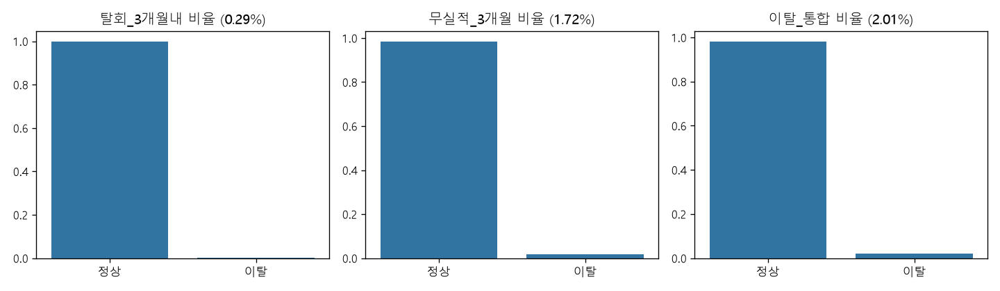
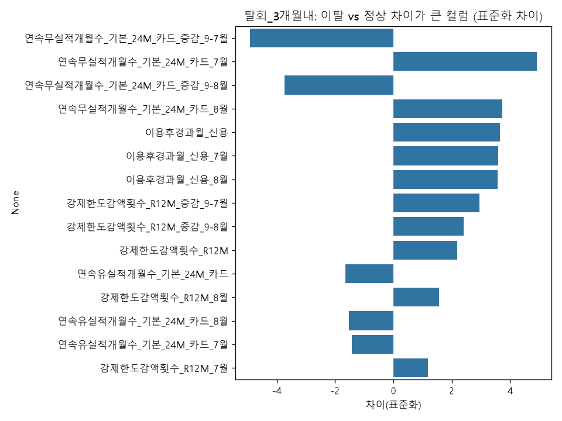
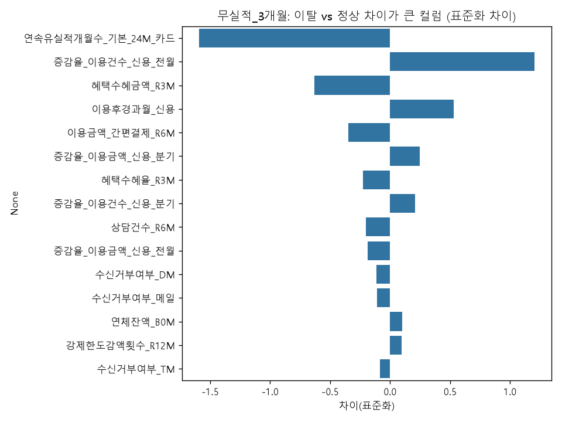
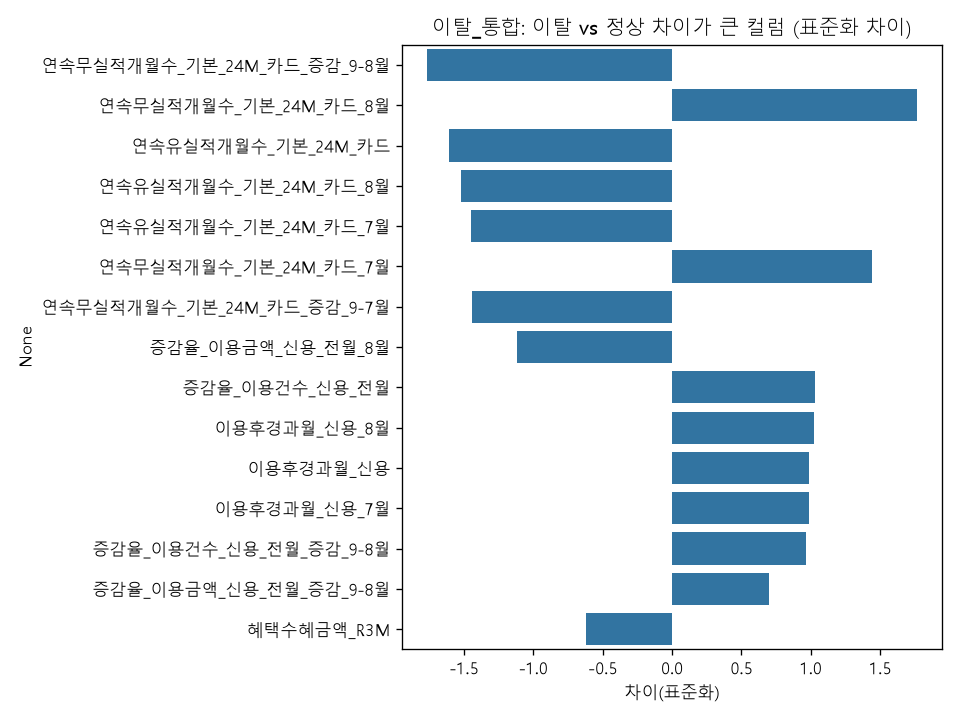
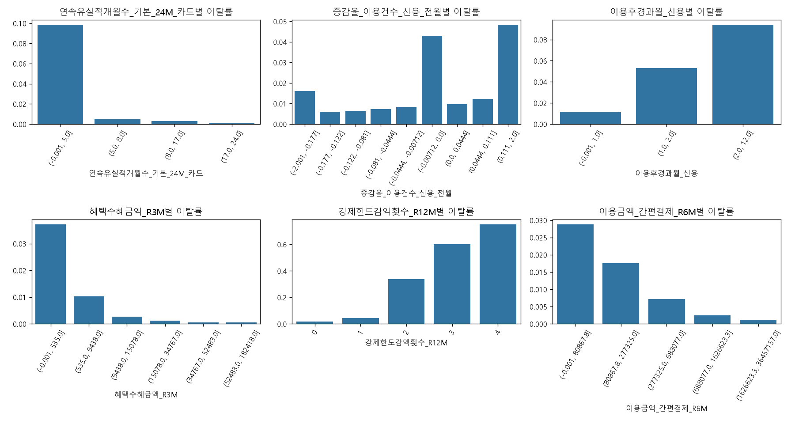
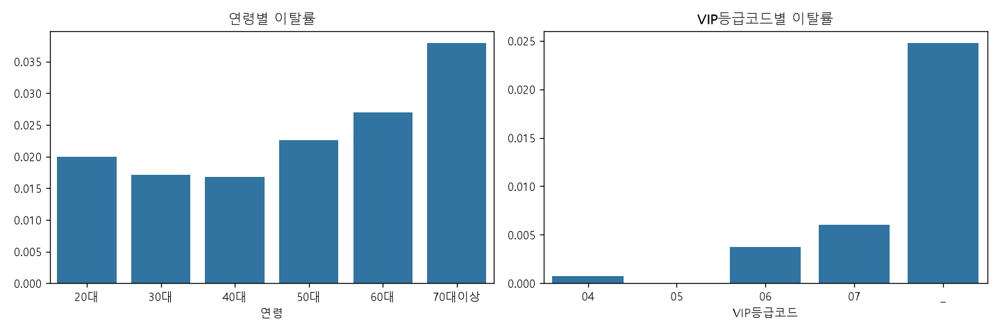
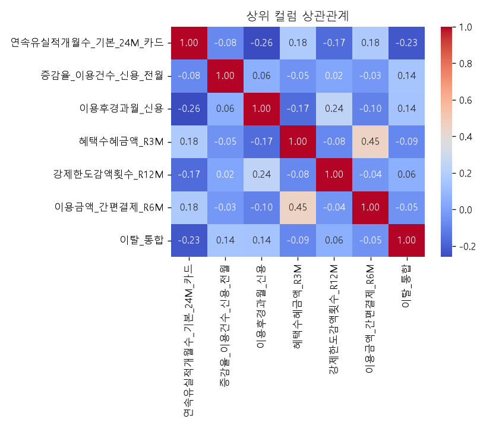

# SKN37_2ND_1Team
---
## 팀원

<!-- prettier-ignore-start -->
| 권승현 | 김민혁 | 박세윤 | 한세현 |
| :---: | :---: | :---: | :---: 
| 이미지 | | 이미지 | 
|  |  |  |  |
<!-- prettier-ignore-end -->

---
## 1. 프로젝트 개요

프로젝트 이름: **💳 카드 고객 이탈 예측 및 대시보드 구축💳**

### 1-1. 개요
본 프로젝트는 국내 카드사의 VIP 회원 금융 데이터를 기반으로 고객 이탈(Churn) 여부를 예측하는 머신러닝 모델을 구축하고, 이를 활용한 인터랙티브 대시보드를 제공하는 것을 목표로 한다. 
2018년 9월 활성 고객 데이터를 기준으로 3개월 내 탈회·무실적 여부를 예측하기 위한 마스터셋을 구성하였으며, 7~8월 과거 이용 특성 및 증감 변수까지 확장한 철저한 탐색적 데이터 분석(EDA)과 전처리를 거쳐 총 6개의 분류 모델(XGBoost, LightGBM, CatBoost, ExtraTrees, Random Forest, MLP)을 적용 및 비교·분석하였다. 나아가 예측 성능을 극대화하고 실시간 대시보드 서빙을 최적화하기 위해 다중 모델 결합(Average Ensemble 및 Stacking) 기법을 도입하여 최종 예측력을 검증하였다.

### 1-2. 프로젝트 배경
<!-- 내용 공백 처리 -->

### 1-3. 프로젝트 목표
- AI Hub 금융 합성 데이터를 활용한 234만여 명 규모의 데이터 통합 및 고객 이탈 예측 모델 설계
- 클래스 불균형(`이탈 통합 비율 2.01%`)을 고려한 정밀한 전처리 및 평가지표(`Recall`, `Precision`, `F1-Score`, `PR-AUC`) 중심 모델 검증
- Streamlit을 활용한 실시간 이탈 예측 및 시각화 대시보드 구현

---
## 2. 🛠 Tech Stack
| Category | Stack |
|----------|-------|
| 💻 Language |  |
| 📊 Data Processing |   |
| 🤖 Machine Learning |          |
| 🖥️ Web Framework |  |
| 📈 Visualization |   |

---

## 3. 업무 분할 구조
* **데이터 전처리 및 EDA**: 원천 데이터 8개 영역 결합, 7~8월 과거 시점 확장 특성 생성, 결측치/이상치 처리, 마스터셋 구성
* **모델링 및 하이퍼파라미터 튜닝**: 10% 샘플 데이터 기반 120개 앙상블 조합 탐색 및 전체 데이터 스케일 업(Scale-up) 재튜닝
* **대시보드 구현**: Streamlit 기반 UI 구성, 최적 앙상블 모델 추론 연동, LLM 피드백 연동 기능 구현

---
## 4. 데이터 수집 및 정의
### 4-1. 금융 합성 데이터 개요
- **데이터 출처**: AI Hub 금융 합성 데이터 (하나카드 원천 기반)
- **원천 범위**: 2018년 7월 ~ 12월 (6개월), 8개 업무 영역, 월별 300만 행
- **분석 기준 시점**: 2018년 9월 활성 고객 대상 (2,345,394행 × 41열, 7~8월 과거 특성 확장)

### 4-2. 목표 변수(Target) 정의 및 비율
- **탈회 3개월 내 (`탈회_3개월내`)**: 비율 **0.29%**
- **무실적 3개월 (`무실적_3개월`)**: 비율 **1.72%**
- **이탈 통합 (`이탈_통합`)**: 탈회 또는 무실적 조건을 충족하는 경우, 비율 **2.01%** (정상 고객 97.99%)

  

>  **클래스 불균형**: 정상 고객이 97.99%로 심한 불균형을 보여 정확도(Accuracy) 대신 **Recall, Precision, F1-Score, PR-AUC**를 핵심 평가지표로 활용함.

---
## 5. 데이터 통합 & 전처리 및 EDA

### 5-1. 데이터 변수 사전 (Data Dictionary)
분석 및 모델링에 사용된 총 43개의 설명변수 중, 이탈 판별 기여도가 가장 높은 **핵심 변수 12개**의 명세입니다.

| 분류 | 컬럼명 | 설명 | 비고 |
| :--- | :--- | :--- | :--- |
| **Target** | `이탈_통합` | 기준 시점 이후 3개월 내 탈회 또는 무실적 도달 여부 | 1: 이탈, 0: 정상 (이탈률 2.01%) |
| **Target** | `탈회_3개월내` | 기준 시점 이후 3개월 내 탈회 여부 | 0.29% |
| **Target** | `무실적_3개월` | 기준 시점 이후 3개월 간 이용 실적 중단 여부 | 1.72% |
| **이용패턴** | `연속유실적개월수_기본_24M_카드` | 과거 24개월 중 연속으로 카드 실적이 발생한 개월 수 | 무실적 및 통합 이탈 차이 1위 변수 |
| **이용패턴** | `연속무실적개월수_기본_24M_카드_7/8월` | 7월 및 8월 기준 과거 24개월 내 연속 무실적 개월 수 | 탈회/통합 이탈 위험 주요 변수 |
| **이용패턴** | `이용후경과월_신용` | 신용카드를 마지막으로 이용한 뒤 경과한 개월 수 | 탈회 집단 차이 주요 변수 |
| **변동성** | `연속무실적개월수_증감_9-7/8월` | 9월 대비 7월, 8월의 연속 무실적 개월 수 증감량 | 탈회/통합 이탈 집단 차이 상위 변수 |
| **변동성** | `증감율_이용금액/건수_신용_전월` | 전월 대비 신용카드 이용 금액 및 건수 증감율 | |
| **한도/연체** | `강제한도감액횟수_R12M_증감_9-7/8월` | 9월 대비 과거 월의 강제 한도 감액 횟수 증감량 | 탈회 집단 차이 주요 변수 |
| **혜택** | `혜택수혜금액_R3M_7/8월` | 7월, 8월 기준 최근 3개월 간 고객이 받은 혜택 금액 | |
| **고객특성** | `연령` / `VIP등급코드` | 고객의 연령대 및 VIP 등급 | 더미 인코딩 적용 |

### 5-2. EDA (탐색적 데이터 분석) 단계별 주요 결과
2018년 9월 활성 고객을 기준으로 7~8월 과거 시점 특성 및 월별 증감 변수를 활용하여 다각도로 분석했습니다.

* **1단계: 타겟 변수 및 평가지표 정의**
  * 정상 고객이 97.99%를 차지하는 극심한 불균형 데이터임을 확인하여, Accuracy 대신 PR-AUC와 Recall, Precision 중심의 평가지표를 설정함.
* **2단계: 이탈 vs 정상 집단 간 7~9월 다변량 행동 패턴 비교**
  * **탈회 집단:** 7~8월 시점의 `연속무실적개월수`가 매우 높고, 9월 대비 7/8월 증감 변수에서 가장 뚜렷한 집단 차이를 보임.
  * **무실적 집단:** 7, 8, 9월 전반에 걸쳐 `연속유실적개월수`가 정상 집단(약 15개월) 대비 현저히 낮음(약 2.7개월).
  * **통합 이탈:** 8월 시점의 `연속무실적개월수`와 9~8월 증감 변수가 핵심 위험 지표로 확인됨.
* **3단계: 인구통계학적 특성 및 구간별 위험도 분석**
  * 30~40대의 이탈률이 가장 낮았으며, **50대 이후 상승하여 70대 이상 고연령층(약 3.8%)에서 가장 높게** 나타남.
* **4단계: 다중공선성 및 변수 중복성 점검 (상관관계 분석)**
  * 7, 8, 9월의 `연속유실적개월수` 간 매우 높은 양의 상관(0.95~0.97) 및 일부 증감 파생변수 간 완전한 음의 상관(-1.00)을 확인하여 모델 학습 시 변수 중복 통제가 필요함을 점검함.

#### 📊 주요 EDA 시각화 자료
1. **탈회 집단 7~9월 특성 표준화 평균 차이**

  

2. **무실적 집단 7~9월 특성 표준화 평균 차이**

  

3. **통합 이탈 집단 7~9월 특성 표준화 평균 차이**

  

4. **월별 연속유/무실적 개월 수 구간별 이탈률**

  

5. **연령대별 및 VIP 등급별 이탈률**

  

6. **7-8월 포함 월별 주요 변수 상관관계 히트맵**

  

### 5-3. 컬럼별 데이터 전처리 내역
머신러닝 모델의 예측 성능을 안정적으로 확보하기 위해 변수의 특성에 맞춘 세밀한 전처리를 수행했습니다. (최종 분할: `X_train` 1,876,315행 : `X_test` 469,079행 = 8 : 2)

| 전처리 기법 | 대상 컬럼 | 처리 방식 및 사유 |
| :--- | :--- | :--- |
| **결측치 처리** | `혜택수혜율_R3M` | • 총 53,750건의 결측치 확인 • 데이터 누수(Leakage) 방지를 위해 Test 셋을 배제하고 Train 데이터의 **중앙값(0.7647)** 으로 대체함 |
| **이상치 제한 (Clipping)** | `최종탈회후경과월`, `이용금액_간편결제_R6M`, `연속유실적개월수_기본_24M_카드`, `혜택수혜금액_R3M`, `캠페인접촉건수_R12M`, `증감율_이용건수_신용_전월/분기`, `증감율_이용금액_신용_전월/분기`, `혜택수혜율_R3M` | • 선형/거리 기반 모델의 왜곡을 방지하기 위해 주요 변수에 IQR 상·하한 경계값 기준 Clip 처리 수행 |
| **더미 인코딩** | `연령`, `VIP등급코드` | • 범주형(Categorical) 변수를 수치형 알고리즘이 인식할 수 있도록 0과 1의 더미 변수로 변환 |
| **스케일링** | 모든 수치형 변수 대상 (41개) | • 변수 간 스케일 차이를 맞추기 위해 StandardScaler 적용 • 데이터 누수 방지를 위해 Train 데이터로만 Fit 후 Test에 Transform 적용 |
| **데이터 누수 통제** | 7-8월 시점 변수 및 증감 변수 | • 9월 예측 시점 미래 정보(타겟 연관) 혼입 검증 및 분모 0 극단값 통제 |

---
## 6. 파생 변수
- 회원·신용·승인매출·청구·잔액·채널·마케팅·성과정보에서 선정한 변수를 고객-월 단위로 결합하고, 7~8월 과거 추세 및 증감 파생변수를 추가 생성하여 모델 입력 변수로 구축.

---

## 7. 모델링 및 평가 (전체 데이터 학습 기준)

*(※ 데이터 스케일 확장에 따른 과적합 방지를 위해, 먼저 10% 샘플 데이터로 탐색한 뒤 전체 데이터에 맞게 하이퍼파라미터를 재조정함)*

### 7-1. 전체 데이터 단일 모델 최종 성능

| 모델명 | PR-AUC | ROC-AUC | Recall | Precision | F1-Score |
| :--- | :---: | :---: | :---: | :---: | :---: |
| **ExtraTrees (ET)** | **0.4563** | 0.9630 | 0.8114 | 0.2812 | 0.4177 |
| **LightGBM (LGBM)** | **0.4526** | 0.9633 | **0.8198** | 0.2815 | 0.4191 |
| **XGBoost (XGB)** | **0.4555** | 0.9632 | 0.8149 | 0.2816 | 0.4186 |
| **CatBoost (CAT)** | **0.4528** | 0.9631 | 0.8089 | **0.2863** | **0.4229** |

### 7-2. 다중 모델 앙상블 시너지 분석 결과

| 순위 | 조합명 (평균 앙상블) | 결합 모델 수 | PR-AUC | ROC-AUC | Recall | Precision | F1-Score | 비고 |
| :---: | :--- | :---: | :---: | :---: | :---: | :---: | :---: | :--- |
| **1** | **LGBM + ET** | **2** | **0.4592** | 0.9641 | 0.8157 | 0.2871 | 0.4247 |  |
| **2** | **LGBM + CAT + ET** | **3** | **0.4591** | **0.9642** | 0.8140 | **0.2880** | **0.4254** | |
| **3** | **XGB + LGBM + ET** | **3** | **0.4590** | 0.9641 | **0.8176** | 0.2868 | 0.4246 | 고재현율(Recall) |

## 8. Streamlit 구현

### 8-1. 실시간 추론 모델 선정 및 탑재
- **선정 모델**: `[최종 선택한 앙상블 조합명]`
- **선정 사유**: 대시보드의 특성상 사용자가 버튼을 클릭했을 때 수 초 이내에 결과를 반환해야 합니다. 따라서 미세한 성능 차이로 무거운 다중 스태킹을 사용하기보다는, PR-AUC 성능을 최고 수준으로 유지하면서도 모델의 가벼움(속도)을 챙길 수 있는 `[선택 조합]` 모델을 최종 백엔드 추론용으로 탑재하였습니다.

---
## 9. 인사이트 및 팀원 회고

### 9-1. 주요 인사이트
1. **데이터 누수 통제**: 은행 기준인 '12개월 무실적'을 기반으로 Y 데이터를 생성하는 과정에서 타겟 연관성이 지나치게 높은 변수들을 식별하고 통제하는 작업의 중요성을 확인.
2. **클래스 불균형 대응**: 이탈률 2.01%의 불균형 데이터셋에서는 단순 Accuracy가 아닌 PR-AUC, Recall, Precision 중심의 평가 체계가 필수적이며, 모델별로 Precision과 Recall의 트레이드오프를 확인.
3. **대용량 학습 대처**: 234만 행의 전체 데이터를 처음부터 앙상블 학습시키는 것은 시간과 리소스가 모자르다고 판단했습니다. 10% 샘플 데이터로 120개의 앙상블 조합을 사전 테스트하여 최적의 조합을 먼저 찾아냈습니다. 이후 전체 데이터 학습 시에는 트리의 깊이나 리프 노드 최소 샘플 수를 점진적으로 재조정하여 과적합을 예방하는 방식으로 튜닝 시간을 단축할 수 있었습니다.

### 9-2. 팀원 회고
- **권승현**: 
- **김민혁**:  
- **박세윤**: 
- **한세현**:
